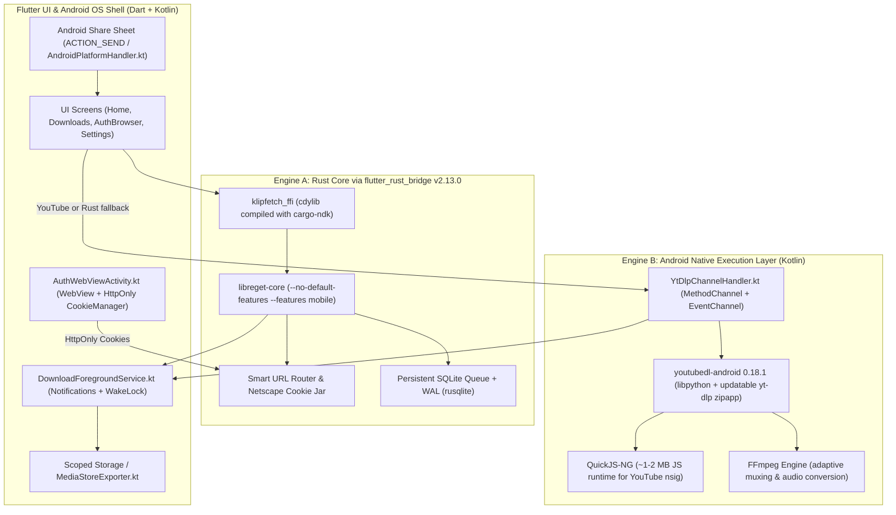

# KlipFetch

> Open-source **Android-only** Flutter media downloader dedicated to **TikTok**, **Instagram**, and **YouTube** — powered by a hybrid **Rust FFI (`libreget-core`) + Android Native (`yt-dlp` + QuickJS-NG + FFmpeg)** architecture.

[](LICENSE)


---

## Overview & Project Scope

**KlipFetch** brings the core media-extraction reliability of [`OpenSelena/libreget`](https://github.com/OpenSelena/libreget) to Android in a focused, mobile-native Flutter application without desktop bloat.

### Strict Scope & Non-Goals
To stay lean, maintainable, and fast on mobile hardware, KlipFetch intentionally enforces strict boundaries:

- **Android-Only**: Exclusively targets Android (`arm64-v8a` and `armeabi-v7a`). **No iOS, Web, Windows, macOS, or Linux builds.**
- **3 Platforms Only**: Exclusively supports **TikTok**, **Instagram**, and **YouTube**. Does **not** include Telegram, BitTorrent, online course scrapers, Bilibili/Pinterest/Reddit/X, or desktop utility suites.
- **Non-Play Store Distribution**: Designed for open-source distribution via **GitHub Releases (split-per-ABI `.apk`)**, **Obtainium**, and **F-Droid / IzzyOnDroid** — not Google Play Store.
- **Independent Identity**: Built as an independent open-source project under **GNU GPL v3.0**. It reuses Rust core crates from LibreGet with attribution, without using LibreGet's brand name, logos, or mascot assets.

---

## Technical Architecture

KlipFetch uses a **Dual-Engine Hybrid Architecture** that combines native Rust speed for social platforms with an independently updatable `yt-dlp` + `FFmpeg` + `QuickJS-NG` execution layer for YouTube and complex adaptive streams.



### 1. Smart URL Routing Strategy
Every URL pasted into the app or received via the Android Share Sheet is classified by the Rust router (`libreget-core`) before starting any download:
- **TikTok & Instagram → Engine A (`libreget-core` via Rust FFI) first, with automatic Engine B fallback**:
  - Native Rust HTTP extractors (`reqwest` with `rustls-tls`) avoid Python cold-start latency, save battery, and support authenticated Instagram features (Stories without marking as seen, Highlights, Carousels) and watermark-free TikTok extraction.
  - If an upstream site layout change temporarily breaks the native Rust extractor, KlipFetch falls back to `youtubedl-android` (`yt-dlp`) automatically.
- **YouTube → Engine B (`youtubedl-android` + QuickJS-NG + FFmpeg) directly**:
  - YouTube frequently rotates player-JS signature (`nsig`) transforms and PO-token requirements and serves high-res streams as separate DASH audio/video tracks.
  - Routing YouTube directly to `youtubedl-android` allows updating the `yt-dlp` zipapp on-device in seconds without releasing a new APK.

### 2. Android SELinux W^X & Background Execution Constraints
Desktop downloaders (including upstream LibreGet's `dependencies.rs`) download standalone executables into an application data directory and call `execve()`. On **Android 10+ (API 29+)**, SELinux W^X policies block executing binaries stored inside writable app data directories.

KlipFetch resolves this cleanly:
1. **Native Executables in Read-Only `jniLibs`**: Python (`libpython`), FFmpeg, `aria2c`, and **QuickJS-NG** are packaged inside the APK's native library directory (`android:extractNativeLibs="true"` in `AndroidManifest.xml` and `useLegacyPackaging = true` in `android/app/build.gradle.kts`), which Android mounts with execute permission.
2. **Runtime-Updatable `yt-dlp` Zipapp**: Only pure-Python `yt-dlp` zipapp scripts are stored and updated in writable app storage and interpreted by the bundled `libpython`.
3. **QuickJS-NG over Deno**: Instead of bundling Deno (~40+ MB) to solve YouTube JS challenges, KlipFetch uses **QuickJS-NG** (~1–2 MB) to keep APK sizes lean.
4. **Resilient Background Downloads**: Long transfers run inside `DownloadForegroundService.kt` with a persistent progress notification, pause/cancel actions, partial wakelock, and automatic export to `Downloads/KlipFetch/{TikTok,Instagram,YouTube}/` via Android MediaStore.

### 3. Cookie Authentication Without a Browser Extension
On desktop, LibreGet captures logged-in sessions via a Chrome/Firefox extension bridge over `127.0.0.1`. On Android, KlipFetch replaces this with a native Android `WebView` + `CookieManager` flow ([`AuthWebViewActivity.kt`](android/app/src/main/kotlin/io/github/fyou00/klipfetch/AuthWebViewActivity.kt) + [`AuthBrowserScreen`](lib/features/auth/auth_browser_screen.dart)):
- Users sign in to Instagram, TikTok, or YouTube inside the app's clean mobile-UA WebView (`User-Agent` free of `; wv` for Google OAuth compatibility).
- `CookieManager.getInstance().getCookie()` captures **`HttpOnly`** and session cookies directly from Android's cookie store and serializes them locally into Netscape `cookies.txt` inside app-private storage (without logging raw token values), shared seamlessly between `libreget-core` and `yt-dlp`.

---

## Tech Stack

| Layer | Technology / Package | Target Version | Role in KlipFetch |
|---|---|---|---|
| **UI Framework** | Flutter & Dart | Flutter `3.47.9` / Dart `3.13.7` | Android Material 3 UI (`Home`, `Downloads`, `Accounts & Cookies`, `Settings`) |
| **State & Navigation** | `flutter_riverpod` | `2.6.1` | Reactive `Notifier` queue/settings state, Share Sheet handling, Material 3 `NavigationBar` |
| **Rust ↔ Dart FFI** | `flutter_rust_bridge` + `cargo-ndk` | `2.13.0` | Async FFI bindings & `StreamSink` progress telemetry (`arm64-v8a`, `armeabi-v7a`) |
| **Native Core** | `libreget-core` (`OpenSelena/libreget`) | `--features mobile` | Native TikTok/Instagram extractors, `rustls` TLS, URL router, `rusqlite` SQLite WAL queue |
| **Android Bridge** | Kotlin + Android Gradle Plugin | Kotlin `2.4.0` / AGP `9.1.0` | Method/Event channels, `DownloadForegroundService.kt`, `MediaStoreExporter.kt`, `AuthWebViewActivity.kt` |
| **YouTube & Fallback Engine** | `io.github.junkfood02.youtubedl-android` | `0.18.1` | Bundled Python + updatable `yt-dlp` zipapp + FFmpeg + `aria2c` |
| **JS Challenge Runtime** | QuickJS-NG | Mobile JNI hook | Lightweight JS evaluator (`libquickjs.so`) for YouTube `nsig` transforms |
| **CI/CD & Releases** | GitHub Actions (`ubuntu-latest`) | Temurin JDK `17` | Dependency audits, Rust/Flutter tests, debug CI APKs, signed `--split-per-abi` Releases + SHA-256 |

---

## Platform Support Matrix

| Platform | Implemented Capabilities | Primary Engine | Fallback Engine | Auth Needed? |
|---|---|---|---|---|
| **TikTok** | Single videos, photo slideshows (incl. non-`.jpeg` & optional background audio toggle), audio-only extraction | `libreget-core` (Rust) | `youtubedl-android` (`yt-dlp`) | Optional (region/age-gated) |
| **Instagram** | Posts, Reels, multi-item Carousels (350 ms pacing & batch export), Stories & Highlights, Reel audio | `libreget-core` (Rust) | `youtubedl-android` (`yt-dlp`) | Required for Stories / private accounts |
| **YouTube** | Videos (4K/2160p, 2K/1440p, 1080p, 720p, 480p), Shorts, selective Playlist picker, MP4/MKV muxing, Audio-only (M4A/MP3/Opus), Subtitles (SRT/VTT), SponsorBlock | `youtubedl-android` + QuickJS-NG + FFmpeg | — | Optional (members-only / age-restricted / anti-bot) |

---

## Project Structure

> **Current Repository State**: Phases 0–4 are implemented and verified in CI (awaiting user-supplied release keystore secrets and physical Android 10–15 device QA verification — see [`PLAN.md`](PLAN.md) and [`docs/RELEASE_AND_QA.md`](docs/RELEASE_AND_QA.md)).

```text
klipfetch/
├── .github/workflows/
│   ├── ci.yml                     # Audit, Rust tests, arm64 NDK FFI, Flutter checks, debug APK artifact
│   └── release.yml                # Tagged/dry-run dual-ABI (--split-per-abi) release APKs + SHA256SUMS.txt
├── android/app/
│   ├── build.gradle.kts           # AGP 9.1.0, W^X jniLibs, release signing & R8, split-per-abi config
│   ├── proguard-rules.pro         # R8 keep rules for KlipFetch, Flutter, youtubedl-android, JNA
│   └── src/main/kotlin/io/github/fyou00/klipfetch/
│       ├── MainActivity.kt
│       ├── AndroidPlatformHandler.kt
│       ├── AuthWebViewActivity.kt
│       ├── DownloadForegroundService.kt
│       ├── MediaStoreExporter.kt
│       └── YtDlpChannelHandler.kt
├── docs/
│   └── RELEASE_AND_QA.md          # Keystore setup, Obtainium/F-Droid guide, Android 10–15 QA matrix
├── fastlane/metadata/android/     # Localized en-US and id metadata & changelogs (Obtainium / F-Droid)
├── lib/
│   ├── app/klipfetch_app.dart     # Material 3 shell, Share Sheet listener, bootstrap
│   ├── features/                  # auth/, downloads/, home/, settings/
│   ├── models/                    # AppSettings, AuthModels, DownloadModels, MediaPlatform, Probe, QueueItem
│   ├── services/                  # AndroidPlatform, Cookie, NetscapeCodec, Queue, RustCore, Settings, Router, YtDlp
│   ├── src/rust/                  # Generated flutter_rust_bridge v2.13.0 bindings
│   ├── state/providers.dart       # Riverpod Notifier controllers
│   ├── theme/app_theme.dart
│   └── widgets/platform_badge.dart
├── rust/                          # klipfetch_ffi cdylib crate (SQLite WAL queue + libreget-core bridge)
├── scripts/audit_dependencies.sh  # Automated GPL-3.0, non-GMS, Android-only & pure-Rust TLS check
├── third_party/libreget-core/     # Vendored mobile-pruned libreget-core (TikTok + Instagram only)
├── test/                          # Flutter unit & widget tests
├── AGENTS.md
├── CHANGELOG.md
├── LICENSE                        # GNU General Public License v3.0
├── PLAN.md
└── README.md
```

---

## Development Prerequisites & Build Commands

### Required Toolchain (Local APK & Rust NDK Builds)
- **Flutter SDK**: `3.47.9` (Dart `3.13.7`)
- **Java Development Kit**: **JDK 17** (Temurin / OpenJDK 17)
- **Android SDK & NDK**: API 34/35 + NDK r26+ (for `cargo-ndk`)
- **Rust Toolchain**: `rustc` 1.85+ with Android targets:
  ```bash
  rustup target add aarch64-linux-android armv7-linux-androideabi
  cargo install cargo-ndk
  cargo install flutter_rust_bridge_codegen
  ```

### Common Verification Commands
```bash
# GPL-3.0, non-GMS, and Android-only audit
./scripts/audit_dependencies.sh

# Flutter static checks and tests
flutter pub get
flutter analyze
flutter test

# Rust mobile core checks & FFI cross-compilation
cargo test --manifest-path third_party/libreget-core/Cargo.toml --no-default-features --features mobile
cargo test --manifest-path rust/Cargo.toml
cd rust && cargo ndk -t arm64-v8a -t armeabi-v7a --platform 24 -o ../android/app/src/main/jniLibs build --release

# Android APK builds (requires JDK 17 + Android SDK)
flutter build apk --debug --target-platform android-arm64
flutter build apk --release --split-per-abi --target-platform android-arm,android-arm64
```

---

## Distribution Policy

Because Google Play Store restricts apps capable of downloading YouTube videos and authenticated social media streams, **KlipFetch will not be published on Google Play**. Releases are distributed via:
1. **GitHub Releases** — signed `--split-per-abi` APKs (`klipfetch-v<ver>-arm64-v8a.apk`, `klipfetch-v<ver>-armeabi-v7a.apk`) + `SHA256SUMS.txt` built transparently via [`.github/workflows/release.yml`](.github/workflows/release.yml).
2. **Obtainium** — direct release tracking from this GitHub repository (setup details in [`docs/RELEASE_AND_QA.md`](docs/RELEASE_AND_QA.md)).
3. **F-Droid / IzzyOnDroid** — reproducible GPL-3.0 metadata under [`fastlane/metadata/android/`](fastlane/metadata/android/), verified clean of Google Play Services and proprietary trackers.

---

## License & Credits

KlipFetch is free, open-source software licensed under the **[GNU General Public License v3.0](LICENSE)**.

### Attribution & Upstream Credits
- **[OpenSelena/libreget](https://github.com/OpenSelena/libreget)** (GPL-3.0) — Rust core architecture, native extractors (`libreget-core`), and queue design.
- **[OmniGet](https://github.com/tonhowtf/omniget)** — original upstream inspiration of LibreGet.
- **[yt-dlp](https://github.com/yt-dlp/yt-dlp)** & **[junkfood02/youtubedl-android](https://github.com/junkfood02/youtubedl-android)** — YouTube/fallback extraction engine on Android.
- **[FFmpeg](https://ffmpeg.org/)** & **[QuickJS-NG](https://github.com/quickjs-ng/quickjs)** — adaptive media muxing and lightweight JS challenge execution.

> **Disclaimer**: KlipFetch is an independent project and is **not** affiliated with OpenSelena, LibreGet, OmniGet, TikTok, Instagram/Meta, or YouTube/Google. Users are responsible for respecting copyright laws and each platform's terms of service. KlipFetch does not bypass DRM or paywalls.
