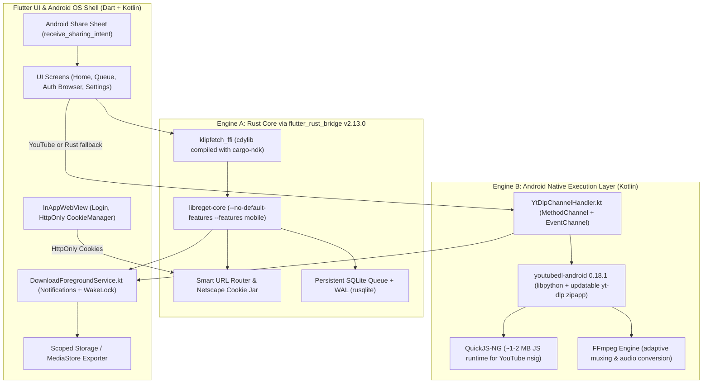

# KlipFetch

> Open-source **Android-only** Flutter media downloader dedicated to **TikTok**, **Instagram**, and **YouTube** — powered by a hybrid **Rust FFI (`libreget-core`) + Android Native (`yt-dlp` + QuickJS-NG + FFmpeg)** architecture.

[](LICENSE)


---

## Overview & Project Scope

**KlipFetch** brings the core media-extraction reliability of [`OpenSelena/libreget`](https://github.com/OpenSelena/libreget) to Android in a focused, mobile-native Flutter application without desktop bloat.

### Strict Scope & Non-Goals
To stay lean, maintainable, and fast on mobile hardware, KlipFetch intentionally enforces strict boundaries:

- **Android-Only**: Exclusively targets Android (`arm64-v8a` and `armeabi-v7a`). **No iOS, Web, Windows, macOS, or Linux builds.**
- **3 Platforms Only**: Exclusively supports **TikTok**, **Instagram**, and **YouTube**. Does **not** include Telegram, BitTorrent, online course scrapers, Bilibili/Pinterest/Reddit/X, or desktop utility suites.
- **Non-Play Store Distribution**: Designed for open-source distribution via **GitHub Releases (split-per-ABI `.apk`)**, **Obtainium**, and **F-Droid / IzzyOnDroid** — not Google Play Store.
- **Independent Identity**: Built as an independent open-source project under **GNU GPL v3.0**. It reuses Rust core crates from LibreGet with attribution, without using LibreGet's brand name, logos, or mascot assets.

---

## Technical Architecture

KlipFetch uses a **Dual-Engine Hybrid Architecture** that combines native Rust speed for social platforms with an independently updatable `yt-dlp` + `FFmpeg` + `QuickJS-NG` execution layer for YouTube and complex adaptive streams.



### 1. Smart URL Routing Strategy
Every URL pasted into the app or received via the Android Share Sheet is classified by the Rust router (`libreget-core`) before starting any download:
- **TikTok & Instagram → Engine A (`libreget-core` via Rust FFI) first, with automatic Engine B fallback**:
  - Native Rust HTTP extractors (`reqwest` with `rustls-tls`) avoid Python cold-start latency, save battery, and support authenticated Instagram features (Stories without marking as seen, Highlights, Carousels) and watermark-free TikTok extraction.
  - If an upstream site layout change temporarily breaks the native Rust extractor, KlipFetch falls back to `youtubedl-android` (`yt-dlp`) automatically.
- **YouTube → Engine B (`youtubedl-android` + QuickJS-NG + FFmpeg) directly**:
  - YouTube frequently rotates player-JS signature (`nsig`) transforms and PO-token requirements and serves high-res streams as separate DASH audio/video tracks.
  - Routing YouTube directly to `youtubedl-android` allows updating the `yt-dlp` zipapp on-device in seconds without releasing a new APK.

### 2. Android SELinux W^X & Background Execution Constraints
Desktop downloaders (including upstream LibreGet's `dependencies.rs`) download standalone executables into an application data directory and call `execve()`. On **Android 10+ (API 29+)**, SELinux W^X policies block executing binaries stored inside writable app data directories.

KlipFetch resolves this cleanly:
1. **Native Executables in Read-Only `jniLibs`**: Python (`libpython`), FFmpeg, `aria2c`, and **QuickJS-NG** are packaged inside the APK's native library directory (`android:extractNativeLibs="true"` in `AndroidManifest.xml` and `useLegacyPackaging = true` in `android/app/build.gradle.kts`), which Android mounts with execute permission.
2. **Runtime-Updatable `yt-dlp` Zipapp**: Only pure-Python `yt-dlp` zipapp scripts are stored and updated in writable app storage and interpreted by the bundled `libpython`.
3. **QuickJS-NG over Deno**: Instead of bundling Deno (~40+ MB) to solve YouTube JS challenges, KlipFetch uses **QuickJS-NG** (~1–2 MB) to keep APK sizes lean.
4. **Resilient Background Downloads**: Long transfers run inside `DownloadForegroundService.kt` with a persistent progress notification, pause/cancel actions, partial wakelock, and automatic export to `Downloads/KlipFetch/{TikTok,Instagram,YouTube}/` via Android MediaStore.

### 3. Cookie Authentication Without a Browser Extension
On desktop, LibreGet captures logged-in sessions via a Chrome/Firefox extension bridge over `127.0.0.1`. On Android, KlipFetch replaces this with an embedded **`flutter_inappwebview`** authentication browser:
- Users sign in to Instagram, TikTok, or YouTube directly inside the app's WebView.
- `CookieManager.instance().getCookies()` reads session cookies—including **`HttpOnly` cookies** invisible to `document.cookie`—and stores them locally in Netscape `cookies.txt` format shared between `libreget-core` and `yt-dlp`.

---

## Tech Stack

| Layer | Technology / Package | Target Version | Role in KlipFetch |
|---|---|---|---|
| **UI Framework** | Flutter & Dart | Flutter `3.47.9` / Dart `3.13.7` | Android Material 3 UI, reactive queue cards, settings |
| **State & Routing** | `flutter_riverpod`, `go_router` | Latest stable | Planned app state management and declarative navigation |
| **Rust ↔ Dart FFI** | `flutter_rust_bridge` + `cargo-ndk` | `2.13.0` | Zero-boilerplate async bindings & `StreamSink` progress events |
| **Native Core** | `libreget-core` (`OpenSelena/libreget`) | `--features mobile` | Native TikTok/Instagram extractors, URL router, HLS/direct downloader, `rusqlite` queue/WAL |
| **Android Bridge** | Kotlin + Android Gradle Plugin | Kotlin `2.4.0` / AGP `9.1.0` | `MethodChannel` / `EventChannel`, Foreground Service, MediaStore |
| **YouTube & Fallback Engine** | `io.github.junkfood02.youtubedl-android` | `0.18.1` | Bundled Python + updatable `yt-dlp` zipapp + FFmpeg + optional `aria2c` |
| **JS Challenge Runtime** | QuickJS-NG | Latest mobile build | Lightweight (~1–2 MB) JS evaluator for YouTube `nsig` transforms |
| **Share & Auth WebView** | `receive_sharing_intent`, `flutter_inappwebview` | `1.8.1` / `6.x` | Receive Android Share Sheet URLs & harvest `HttpOnly` session cookies |
| **CI/CD** | GitHub Actions (`ubuntu-latest`) | Temurin JDK `17` | Automated `flutter analyze`, `flutter test`, and Android APK builds |

---

## Platform Support Matrix (Target Scope)

| Platform | Planned Capabilities | Primary Engine | Fallback Engine | Auth Needed? |
|---|---|---|---|---|
| **TikTok** | Single videos (watermark-free), photo slideshows, audio extraction (M4A/MP3) | `libreget-core` (Rust) | `youtubedl-android` (`yt-dlp`) | Optional (private/age-gated) |
| **Instagram** | Posts, Reels, Carousels, Stories (no seen receipt), Highlights, Reel audio | `libreget-core` (Rust) | `youtubedl-android` (`yt-dlp`) | Required for Stories / private accounts (via InAppWebView) |
| **YouTube** | Videos (up to 4K/2160p & 2K/1440p), Shorts, Playlists, Audio-only (MP3/M4A/Opus), Subtitles (SRT/VTT), SponsorBlock | `youtubedl-android` + QuickJS-NG + FFmpeg | — | Optional (members-only / age-restricted / anti-bot) |

---

## Project Structure

> **Current Repository State**: Phase 0 foundation is initialized (Android-only Flutter scaffold, GPL-3.0 license, documentation, and Android CI). Planned modules below are tracked in [PLAN.md](PLAN.md).

```text
klipfetch/
├── .github/workflows/
│   └── ci.yml                 # Automated Flutter analyze, test & Android debug APK build
├── android/                   # Android Gradle project (Kotlin, AGP 9.1.0, Java 17)
│   └── app/src/main/kotlin/io/github/fyou00/klipfetch/
│       └── MainActivity.kt    # (Planned) YtDlpChannelHandler & DownloadForegroundService
├── lib/                       # Flutter Dart application
│   └── main.dart              # (Planned) features/{home,downloads,auth_browser,settings}, rust/ FFI bindings
├── test/                      # Flutter unit & widget tests
├── rust/                      # (Planned Phase 1) flutter_rust_bridge v2 FFI crate
├── third_party/libreget/      # (Planned Phase 0) Upstream OpenSelena/libreget core submodule/fork
├── AGENTS.md                  # Guardrails and workflow rules for AI agents & contributors
├── CHANGELOG.md               # Versioned release & development history
├── LICENSE                    # GNU General Public License v3.0
├── PLAN.md                    # Detailed 5-phase Android implementation roadmap
└── README.md                  # Project overview, architecture & tech stack
```

---

## Development Prerequisites & Build Commands

### Required Toolchain (Local APK & Rust NDK Builds)
- **Flutter SDK**: `3.47.9` (Dart `3.13.7`)
- **Java Development Kit**: **JDK 17** (Temurin / OpenJDK 17)
- **Android SDK & NDK**: API 34/35 + NDK r26+ (for `cargo-ndk`)
- **Rust Toolchain**: `rustc` 1.85+ with Android targets:
  ```bash
  rustup target add aarch64-linux-android armv7-linux-androideabi
  cargo install cargo-ndk
  cargo install flutter_rust_bridge_codegen
  ```

### Common Verification Commands
```bash
# Flutter static checks and tests
flutter pub get
flutter analyze
flutter test

# Android APK builds (requires JDK 17 + Android SDK)
flutter build apk --debug --target-platform android-arm64
flutter build apk --release --split-per-abi

# Rust mobile core checks (available once Phase 0/1 Rust workspace is added)
cargo check --manifest-path third_party/libreget/src-tauri/libreget-core/Cargo.toml --no-default-features --features mobile
cargo ndk -t arm64-v8a build --manifest-path rust/Cargo.toml --release
```

---

## Distribution Policy

Because Google Play Store restricts apps capable of downloading YouTube videos and authenticated social media streams, **KlipFetch will not be published on Google Play**. Releases are distributed via:
1. **GitHub Releases** — signed `--split-per-abi` APKs (`arm64-v8a`, `armeabi-v7a`) built transparently via GitHub Actions.
2. **Obtainium** — direct release tracking from this GitHub repository.
3. **F-Droid / IzzyOnDroid** — reproducible open-source distribution compatible with GPL-3.0.

---

## License & Credits

KlipFetch is free, open-source software licensed under the **[GNU General Public License v3.0](LICENSE)**.

### Attribution & Upstream Credits
- **[OpenSelena/libreget](https://github.com/OpenSelena/libreget)** (GPL-3.0) — Rust core architecture, native extractors (`libreget-core`), and queue design.
- **[OmniGet](https://github.com/tonhowtf/omniget)** — original upstream inspiration of LibreGet.
- **[yt-dlp](https://github.com/yt-dlp/yt-dlp)** & **[junkfood02/youtubedl-android](https://github.com/junkfood02/youtubedl-android)** — YouTube/fallback extraction engine on Android.
- **[FFmpeg](https://ffmpeg.org/)** & **[QuickJS-NG](https://github.com/quickjs-ng/quickjs)** — adaptive media muxing and lightweight JS challenge execution.

> **Disclaimer**: KlipFetch is an independent project and is **not** affiliated with OpenSelena, LibreGet, OmniGet, TikTok, Instagram/Meta, or YouTube/Google. Users are responsible for respecting copyright laws and each platform's terms of service. KlipFetch does not bypass DRM or paywalls.
